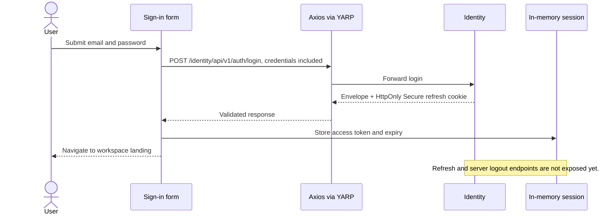

# Authentication and workspace navigation

The current frontend supports the verified Identity registration and login contracts and an in-memory access session. It cannot restore a session after reload or revoke it server-side because neither endpoint is exposed by Identity or YARP. Sign-out immediately clears the local token and cache and tells the user server-side revocation is unconfirmed. This is a partial authentication implementation; it is not a complete production session lifecycle.

## Login and request flow

1. `SignInForm` uses React Hook Form and Zod for email and required-password validation. It sends no secrets to logs or URLs and prevents repeated submissions while pending.
2. `loginApi.ts` POSTs `{ email, password }` through the existing Axios transport to `/identity/api/v1/auth/login`. The login-specific client allows browser-managed cookie credentials only for this exact POST, after origin/path validation, and does not attach an access token. The browser processes `Set-Cookie`; JavaScript neither reads nor writes the refresh cookie.
3. The response must be a successful backend envelope containing a GUID user ID, a non-empty three-part JWT, `Bearer` token type, and a future ISO timestamp with a 30-second minimum validity margin. Validation checks format, not JWT signature; the API is responsible for cryptographic verification and authorization.
4. Only the central in-memory `authSession` holds the access token. Its observable snapshot contains user ID and expiry, never the token. Neither credentials nor login responses pass through TanStack Query or its mutation cache. The shared client injects the token only inside the configured API boundary. It blocks redirects and cookie credentials for ordinary API calls.
5. Successful sign-in clears previous cached server data and navigates to an approved UUID workspace path, workspace selection, or an owned invitation continuation. Discovery reads the account's eligible workspaces. Workspace entry requires a fresh `/organizations/{organizationId}/members/me` read before dependent UI. Navigation and cached role badges never grant access.



A login attempt carries a generation number. Sign-out, a newer attempt, or unmount invalidates a stale response. A 401 on a bearer request clears only the session generation that sent it; a late 401 cannot clear a later session. A 403 remains an authorization error and does not clear the session. No request is automatically replayed. The expiry timer and a token-read check clear the session 30 seconds before expiry; there is no unverified refresh call. The app starts anonymous on reload because the access token is intentionally memory-only and a refresh endpoint does not exist. This is a known limitation, not proof that the browser cookie is missing.

The React guard redirects anonymous users before protected workspace content renders. Return paths admit `/workspaces`, one `/w/<organization-UUID>` path, and exact `/join-workspace` only while a live invitation continuation is owned. External URLs, query/hash-bearing continuations, and legacy arbitrary slugs are ignored. An authenticated sign-in redirect preserves an owned invitation flow. Successful login is not cancelled merely because navigation unmounts the sign-in form; pending anonymous attempts are still retired on unmount.

Organization requests use bearer authorization and ordinary credential omission. A member-me 403 removes the workspace scope and returns to selection while retaining the valid identity. A member, invitation, catalog, or audit read denial clears only that protected resource. The delegable permission subset is not complete capability discovery. Invitation preview and response require current-account proof admission, not existing workspace membership; proof never enters storage, navigation state, query/mutation caches, or error diagnostics.

## Registration and invitation recovery

`/sign-up` submits displayName, email and password through the existing public registration contract. It uses an anonymous, cookie-omitting client and imperative local state, never a Query mutation. Duplicate submission, unmount cancellation, safe failures and Retry-After are handled. The success screen confirms account creation, clears the form and links to sign-in; it creates no session or workspace membership. Both auth routes ignore demo state query parameters.

Navigating from an invitation to registration retires its proof. Register, sign in with the invited email, then reopen the original invitation email to preview and accept it. Do not persist the proof or pass it through registration/router state. Existing-account same-tab sign-in continuation remains supported. Authenticated visits to sign-up redirect to workspace selection.

## Local setup

Copy `.env.example` to `.env.local`, set `VITE_API_BASE_URL=/identity/` and `DEV_API_PROXY_TARGET=http://127.0.0.1:19090`, and start the application with `npm run dev`. Vite binds port 5173 with strictPort enabled and fails rather than silently changing the email landing origin. Use `http://127.0.0.1:5173` consistently rather than mixing hostnames. Vite forwards the `/identity` prefix unchanged to YARP and forwards Set-Cookie responses. The `VITE_` value is public and must not contain secrets. The local proxy is development-only; deploy a same-origin gateway or configure explicit secure cross-origin behavior in production.

The backend sets `dp_refresh_token` with HttpOnly, Secure, SameSite=Strict, Path=/, and a backend expiration. Secure-cookie treatment on HTTP loopback varies by browser and hostname; use trusted local HTTPS when necessary. The gateway and Identity can be checked without an account using a synthetic invalid login, but successful cookie issuance and storage require a real test account and browser inspection. Do not disable Secure or relax SameSite to make testing work. For cross-origin access, credentialed CORS needs the exact allowed origin and `Access-Control-Allow-Credentials`; CORS does not override SameSite.

## Required backend work before full production authentication

The audited `AuthController` and `proxy.json` expose register and login only. `IAuthSessionService` and `AuthSessionService` contain internal verifier rotation and revocation operations, row locking, expiry and single-use checks, but no browser-facing refresh/logout routes. Old-token reuse is rejected and does not revoke the current session; stronger replay detection/family revocation is not established. Internal methods are not browser contracts.

Backend owners must approve and implement:

- A credentialed refresh endpoint routed through YARP, with a documented method, request and error semantics, rotated `Set-Cookie`, and the same validated token/user/expiry envelope. Add CSRF defenses appropriate to the deployment (such as Origin validation plus an agreed token mechanism). SameSite is defense in depth, not a universal CSRF replacement.
- A logout endpoint that verifies the session, revokes it server-side, and expires the HttpOnly cookie with matching path/domain/security attributes. Define failure semantics, replay detection, concurrent rotation and multi-tab behavior.
- A general current-user contract if future account UI needs one. Organization now supplies account discovery and current own-membership endpoints with UUID scoping; no general effective-capability endpoint exists. The internal Users controller requires a service API key and must not be called from the browser.
- Gateway routes and integration tests for these endpoints. Specify 401 versus temporary server/network failures; enable restoration with an initializing state and single-flight refresh only after the contract exists. Define retry safety for writes and cross-tab coordination without broadcasting tokens.

Current local sign-out cannot revoke the server session or delete its HttpOnly cookie. A reload loses the access token and requires another sign-in. Access tokens already issued may remain valid server-side until expiry or server-side revocation. In-memory storage reduces persistence exposure but cannot protect against malicious script running in the origin (XSS). Never put tokens in localStorage, sessionStorage, IndexedDB, persisted Zustand, query caches, JavaScript cookies, or URLs.

## Verification

```powershell
npm ci
npm run dev
npm run typecheck
npm run lint
npm run format:check
npm run test:run
npm run build
```

MSW-based authentication tests cover successful and failed login, credential inclusion, malformed envelopes, no browser token storage, repeated submissions, protected routes, scoped navigation, 401/403 distinction, cache clearing, and stale asynchronous results. Tests use fictional credentials and tokens. The current backend's invalid-credential behavior was also exercised through local YARP; real successful login/cookie behavior, refresh, logout and membership require the backend contracts and a valid test account.

Historical authentication-only verification: typecheck, lint, formatting, 98 tests, and build passed, with a >500 kB chunk warning at that time. Browser checks then covered desktop/mobile sign-in, the Gateway invalid-credentials response, and anonymous workspace redirect; successful login/cookie attributes were not checked. Current Organization integration results and remaining browser/live limitations are in [verification.md](verification.md#11-organization-integration--6-november-2026).
