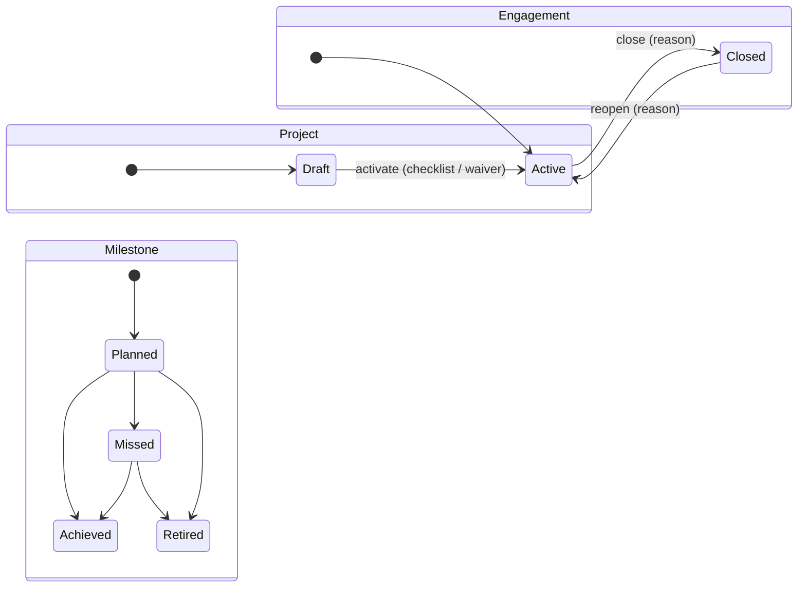
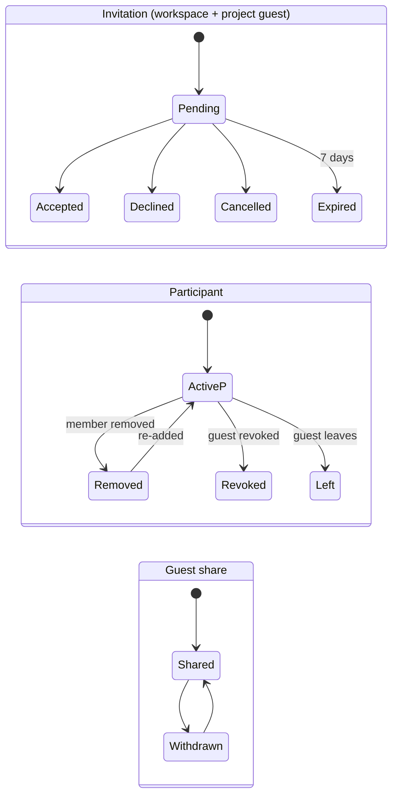

# 01 — Requirements: personas, epics, stories, rules, permissions

Source IDs (FR-DP-…, US-DP-…, BR-…) point into the backend repository `DeliveryPilot/docs`. Stories here are **UI stories**: they restate backend behavior as observable screen behavior and never add business rules.

MoSCoW: **M** must, **S** should, **C** could, **W** won't (this plan). Phase: **P-Live** existing connected page, **P1** first mock-backed slice, **P2** second slice.

## 1. Personas and goals

| Persona                                            | UI goal in this plan                                                          | Main pages        |
| -------------------------------------------------- | ----------------------------------------------------------------------------- | ----------------- |
| Prospective user                                   | Create an account, then sign in                                               | 02, 03            |
| Workspace Owner (agency founder/CTO)               | Create the workspace, control Admins and ownership, recover orphaned projects | 04, 05, 16        |
| Workspace Admin                                    | Manage members, roles, invitations, audit                                     | 05                |
| Delivery Manager (`engagements.create`/`read-all`) | Record client agreements and see all engagements and their projects           | 08, 09            |
| Engagement manager (`engagements.manage`)          | Edit values, milestones, contacts, close/reopen, link client organization     | 09                |
| Project Administrator                              | Initialize the project, assign client PO, activate, delegate administration   | 11–15, 18         |
| Project Manager (member)                           | Maintain brief, cadence, team, guests, stakeholders, sharing                  | 12–15, 18         |
| Business Analyst                                   | Edit the brief                                                                | 12                |
| Developer / QA / DevOps / Viewer                   | Read project information                                                      | 11, 12, 13 (read) |
| Client guest / client PO                           | Accept project invitation, see admitted projects and shared items only        | 17, 19            |
| Client organization Owner/Admin                    | Confirm or remove a link between their workspace and a vendor engagement      | 10                |

## 2. Epics

| Epic | Name                    | Backend feature | Pages          |
| ---- | ----------------------- | --------------- | -------------- |
| E1   | Account access          | FEAT-DP-002     | 01, 02, 03, 07 |
| E2   | Workspace & membership  | FEAT-DP-003     | 04, 05, 06     |
| E3   | Client engagement       | FEAT-DP-025     | 08, 09, 10     |
| E4   | Project initialization  | FEAT-DP-004     | 11–17          |
| E5   | Client portal & sharing | FEAT-DP-015     | 18, 19         |

## 3. User stories

### E1 / E2 — existing connected pages (documented, not re-built)

| ID      | Story                                                                                | Priority | Phase  | Acceptance (Given/When/Then)                                                                                                                                                                    |
| ------- | ------------------------------------------------------------------------------------ | -------- | ------ | ----------------------------------------------------------------------------------------------------------------------------------------------------------------------------------------------- |
| UI-E1-1 | As a prospective user I register with display name, email and password.              | M        | P-Live | Given valid fields, when I submit, then I see a success message and a link to sign in, and I am **not** signed in. Given a taken email, then I see "This email is exist" under the email field. |
| UI-E1-2 | As a returning user I sign in.                                                       | M        | P-Live | Given valid credentials, when I submit, then I land on `/workspaces`. Given invalid credentials, then I see a non-specific error and the password field is cleared.                             |
| UI-E1-3 | As a signed-in user I sign out.                                                      | M        | P-Live | When I choose "Sign out" in the account menu, then caches are cleared and I land on `/sign-in`.                                                                                                 |
| UI-E2-1 | As a user I see my workspaces and open one.                                          | M        | P-Live | Given memberships, then each card shows name and my role badges; when I choose "Open workspace", then I land on `/w/<id>` after membership is re-checked.                                       |
| UI-E2-2 | As a user I create a workspace.                                                      | M        | P-Live | Given a name 1–160 chars, when I submit, then I become Owner and the new workspace opens. A retried submission never creates a second workspace.                                                |
| UI-E2-3 | As an invitee I accept or decline a workspace invitation from the link.              | M        | P-Live | Given a valid link and matching signed-in email, then I see workspace name and offered roles and can accept or decline.                                                                         |
| UI-E2-4 | As an authorized operator I manage members, roles, invitations, ownership and audit. | M        | P-Live | Each section shows only when the read is permitted; denied reads show the no-permission state.                                                                                                  |

### E3 — Client engagement (FEAT-DP-025)

| ID       | Story                                                                                | Pri | Phase | Source                            | Acceptance                                                                                                                                                                                                                                                                                                                                              |
| -------- | ------------------------------------------------------------------------------------ | --- | ----- | --------------------------------- | ------------------------------------------------------------------------------------------------------------------------------------------------------------------------------------------------------------------------------------------------------------------------------------------------------------------------------------------------------- |
| UI-E3-1  | As a delivery manager I create an engagement.                                        | M   | P1    | FR-025-001, US-025-001            | Given `engagements.create`, when I submit client display name, agreement reference and signed date, then the engagement opens with status Active. Given an Active engagement with the same reference (case-insensitive), then creation succeeds and a warning "Another active engagement uses this agreement reference" is shown on the new engagement. |
| UI-E3-2  | As a delivery leader I list all engagements.                                         | M   | P1    | FR-025-006                        | Given `engagements.read-all`, then I see every engagement of the workspace with status filter Active/Closed/All, 50 per page, "Load more" when `nextCursor` exists. Given no tier, then I see the empty list without error.                                                                                                                             |
| UI-E3-3  | As an engagement manager I set contract value and planned effort.                    | M   | P1    | FR-025-003                        | Given amount empty, I can set amount (≤2 decimals) + currency + effort (≤1 decimal). Given amount set, the currency field is read-only with help text "Clear the amount to change currency".                                                                                                                                                            |
| UI-E3-4  | As an engagement manager I add and maintain milestones.                              | M   | P1    | FR-025-004                        | New milestone shows equal original/current date and status Planned. Changing date requires a reason; the original date remains visible. Achieved/Retired rows offer no actions.                                                                                                                                                                         |
| UI-E3-5  | As an engagement manager I close and reopen an engagement with a reason.             | M   | P1    | FR-025-007                        | After closing, all edit actions are hidden and a Closed banner explains "Closed engagements are read-only. Reopen to edit." Projects stay listed.                                                                                                                                                                                                       |
| UI-E3-6  | As an engagement manager I edit client details and agreement reference.              | S   | P2    | FR-025-002 (contract pending)     | Changing agreement reference or signed date requires a reason. Stale version shows a conflict alert with "Reload engagement".                                                                                                                                                                                                                           |
| UI-E3-7  | As an engagement manager I record contacts and designate one client PO.              | S   | P2    | FR-025-005 (contract pending)     | Designating a second client PO replaces the first; the page states "Designation grants no access."                                                                                                                                                                                                                                                      |
| UI-E3-8  | As a full-detail reader I read engagement history.                                   | S   | P1    | FR-025-010                        | History lists event, actor, UTC time shown as local date-time, reason; never a link code.                                                                                                                                                                                                                                                               |
| UI-E3-9  | As an engagement manager I issue a link code and the client Owner/Admin confirms it. | C   | P2    | FR-025-008/009 (contract pending) | The code is shown once with "Copy code"; later reads show only "Code outstanding, expires 18 Nov 2026". Client side: entering a code shows a preview (engagement + client display name) before "Confirm link". Invalid/expired/used codes show one generic message.                                                                                     |
| UI-E3-10 | As a project participant I see a money-free engagement summary on my project.        | S   | P1    | FR-025-006                        | Summary shows client display name, engagement name, agreement reference, status, milestones; never amount, effort or contacts.                                                                                                                                                                                                                          |

### E4 — Project initialization (FEAT-DP-004)

| ID       | Story                                                                                             | Pri | Phase | Source                 | Acceptance                                                                                                                                                                                                                        |
| -------- | ------------------------------------------------------------------------------------------------- | --- | ----- | ---------------------- | --------------------------------------------------------------------------------------------------------------------------------------------------------------------------------------------------------------------------------- |
| UI-E4-1  | As a member with `projects.create` I create a Draft Scrum project, client or internal.            | M   | P1    | FR-004-001/002         | Name 1–160, purpose 1–500 required. Client projects require picking an **Active** engagement visible with full detail. On success the project opens in Draft and I am Project Administrator.                                      |
| UI-E4-2  | As a participant I see only projects I participate in.                                            | M   | P1    | FR-004-007             | Portfolio lists my projects with status, kind, engagement, my roles, Sprint length. A guessed project ID shows the not-found state, identical to an unknown ID.                                                                   |
| UI-E4-3  | As an Admin/PM/BA I edit the brief and Product Goal; everybody sees which items are missing.      | M   | P1    | FR-004-003             | Each of 7 items ≤4000 chars. Missing items show "Not yet written". Previous Product Goal values are listed under "Earlier Product Goals".                                                                                         |
| UI-E4-4  | As an Admin/member PM I set Sprint length 1–4 weeks.                                              | M   | P1    | FR-004-004             | Select shows 1, 2, 3, 4 weeks; help text "Applies only to Sprints that have not started."                                                                                                                                         |
| UI-E4-5  | As an Admin/member PM I add workspace members as participants with roles, change and remove them. | M   | P1    | FR-004-005/006         | Role checklist excludes Project Administrator unless I am one. Removing the last administrator is blocked with "A project needs at least one administrator." Removal asks for confirmation naming the person.                     |
| UI-E4-6  | As an Admin/member PM I invite a guest by email with one role (not Project Administrator).        | M   | P1    | FR-004-008             | One pending invitation per email; duplicate shows "This person already has a pending invitation." Pending list shows expiry; actions Resend, Cancel.                                                                              |
| UI-E4-7  | As an invitee I accept a project invitation with the matching account.                            | M   | P1    | FR-004-008             | Mismatched email: "This invitation is for a different email address." Workspace member: "You are a member of this workspace. Ask a project administrator to add you as a participant."                                            |
| UI-E4-8  | As a Project Administrator I assign exactly one admitted guest as client PO.                      | M   | P1    | FR-004-009             | Picker lists only active guests. If the engagement designates a client PO contact, that person is marked "Engagement default".                                                                                                    |
| UI-E4-9  | As a Project Administrator I activate a Draft project.                                            | M   | P1    | FR-004-012             | Readiness checklist shows Product Goal, Sprint length, PM participant, engagement (client only), client PO. Missing PO allows activation only with a waiver reason. Any other gap disables "Activate project" and lists the gaps. |
| UI-E4-10 | As an Admin/member PM I maintain the stakeholder register.                                        | S   | P1    | FR-004-011             | Add/edit/retire entries; link to a participant optional; page states "Stakeholder entries grant no access."                                                                                                                       |
| UI-E4-11 | As a Project Administrator I change engagement or client/internal kind while Draft.               | S   | P2    | FR-004-002             | Requires `engagements.manage` too and a reason. Hidden once Active.                                                                                                                                                               |
| UI-E4-12 | As a Project Administrator I grant/remove Project Administrator and step down.                    | S   | P2    | FR-004-013             | Last-admin protection message as UI-E4-5.                                                                                                                                                                                         |
| UI-E4-13 | As a workspace Owner I appoint an administrator for a project with no active administrator.       | C   | P2    | FR-004-013             | List shows only flagged projects (name only); appoint from member participants; reason required; copy states "You will not gain access to project content."                                                                       |
| UI-E4-14 | As Admin/member PM I read the project change history.                                             | S   | P2    | FR-004-005 (OQ-004-18) | Other roles do not see the History area.                                                                                                                                                                                          |
| UI-E4-15 | As a guest I leave a project.                                                                     | S   | P2    | FR-004-010             | Confirmation states "You will lose access to this project immediately."                                                                                                                                                           |

### E5 — Client portal & sharing (FEAT-DP-015)

| ID      | Story                                                                  | Pri | Phase | Source         | Acceptance                                                                                                                                                                                                           |
| ------- | ---------------------------------------------------------------------- | --- | ----- | -------------- | -------------------------------------------------------------------------------------------------------------------------------------------------------------------------------------------------------------------- |
| UI-E5-1 | As a guest I see every project I am admitted to.                       | M   | P1    | FR-015-001     | Each card: project name, status, my roles, "Client Product Owner" badge if assigned, admitted date. No vendor workspace name. No guest participation → empty state, not error.                                       |
| UI-E5-2 | As a guest I open a project's default view.                            | M   | P1    | FR-015-002     | Shows name, purpose, status, Sprint length, Product Goal, my roles, client PO, team (names + roles, guests marked). No emails.                                                                                       |
| UI-E5-3 | As a guest I read shared items.                                        | M   | P1    | FR-015-005/006 | Shared brief items, stakeholder entries (no email/link) and engagement summary (milestones without reasons), each with "Shared on 4 Nov 2026". Nothing shared → section with "Nothing has been shared with you yet." |
| UI-E5-4 | As Admin/member PM I share and withdraw items.                         | M   | P1    | FR-015-003/004 | Each item row has a "Shared"/"Internal" badge and one action. Withdraw asks optional reason. Engagement summary share requires full engagement detail visibility.                                                    |
| UI-E5-5 | As Admin/member PM I preview what guests see and read sharing history. | S   | P1    | FR-015-008     | "Preview as client" renders the guest view components with the current share set, under a banner "Preview — this is what guests of this project see."                                                                |

## 4. Business rules the UI must enforce or reflect

| Rule     | UI behavior                                                                                                                                                                                   | Source                               |
| -------- | --------------------------------------------------------------------------------------------------------------------------------------------------------------------------------------------- | ------------------------------------ |
| BR-UI-01 | Text inputs are trimmed before length validation; limits shown as counters when ≥ 200 chars allowed.                                                                                          | FR-025-001, FR-004-001               |
| BR-UI-02 | Engagement: client display name 1–200; agreement reference 1–100; signed date required; legal name ≤200; country `^[A-Z]{2}$`; engagement name ≤200; document link `https://` absolute ≤2000. | FR-025-001                           |
| BR-UI-03 | Contract amount ≥0, ≤2 decimals; currency `^[A-Z]{3}$`; effort ≥0, ≤1 decimal; currency editable only while amount empty; empty means "Not recorded", never 0.                                | FR-025-003                           |
| BR-UI-04 | Milestone name 1–200, description ≤2000; date change requires reason; transitions Planned→{Achieved,Missed,Retired}, Missed→{Achieved,Retired}.                                               | FR-025-004, `EngagementMilestone.cs` |
| BR-UI-05 | Closed engagement: read-only except reopen and link removal.                                                                                                                                  | FR-025-007                           |
| BR-UI-06 | Project name 1–160, purpose 1–500, brief items ≤4000 each, Sprint length 1–4 (default 2), Scrum fixed (never selectable).                                                                     | FR-004-001/003/004                   |
| BR-UI-07 | Client project requires engagement; engagement/kind changes only while Draft.                                                                                                                 | FR-004-002                           |
| BR-UI-08 | Guest roles: any except ProjectAdministrator. Guests never see management controls.                                                                                                           | FR-004-005/008                       |
| BR-UI-09 | Activation requires Product Goal, Sprint length, ≥1 PM participant, engagement (client); missing client PO → waiver reason ≤2000.                                                             | FR-004-012                           |
| BR-UI-10 | Last active Project Administrator cannot be removed or step down.                                                                                                                             | FR-004-013                           |
| BR-UI-11 | Invitations (workspace and project) expire 7 days after last issue; resend rotates link and restarts 7 days.                                                                                  | INV-05/06, FR-004-008                |
| BR-UI-12 | Product Goal is always guest-visible and never a shareable item; other brief items, stakeholder entries and engagement summary are internal until shared.                                     | FR-015-002/003                       |
| BR-UI-13 | "Not found" and "no permission" for a specific resource ID look identical to avoid existence leaks.                                                                                           | FR-015-007, FR-025-006               |
| BR-UI-14 | Stale `version` → 409 conflict → alert "Someone else changed this. Reload to see the latest version." + "Reload" button; local input kept until reload.                                       | NFR-004                              |
| BR-UI-15 | Dates: date-only values `2 Nov 2026` (UTC); instants as local `2 Nov 2026, 14:05`; numbers `Intl.NumberFormat('en-US')`; money `Intl.NumberFormat('en-US', {style:'currency', currency})`.    | UI-CNT-04                            |
| BR-UI-16 | Work state, QA result, client acceptance and release status are never merged into one status (none exist yet).                                                                                | UI-CNT-05                            |

## 5. Status lifecycles

Status → badge mapping is in `03-design-system.md` §4.2.

## 6. Permission matrix (role × page × action)

Legend: **Y** allowed, **—** hidden, **R** read only, **S** summary only, **(c)** contract pending (mock only). Workspace columns: **Own** Owner, **Adm** Admin, **Mem** Member without grant, **+code** member holding the named code. Project columns: **PA** Project Administrator, **PM** member PM, **BA**, **Dev/QA/Ops/View** other roles, **G-PM/G-BA** guest with that role, **G** other guests.

### 6.1 Workspace-scoped pages

| Page / action                                    | Own              | Adm              | Mem              | +engagements.create | +engagements.read-all | +engagements.manage | Engagement creator |
| ------------------------------------------------ | ---------------- | ---------------- | ---------------- | ------------------- | --------------------- | ------------------- | ------------------ |
| 08 List engagements                              | Y¹               | Y¹               | —                | own only            | Y                     | Y                   | own                |
| 08 Create engagement                             | Y¹               | Y¹               | —                | Y                   | —                     | —                   | —                  |
| 09 View full detail                              | Y¹               | Y¹               | —                | own only            | Y                     | Y                   | Y                  |
| 09 Edit details / contacts (c)                   | Y¹               | Y¹               | —                | —                   | —                     | Y                   | —                  |
| 09 Set value & effort                            | Y¹               | Y¹               | —                | —                   | —                     | Y                   | —                  |
| 09 Milestones add/edit/date/status               | Y¹               | Y¹               | —                | —                   | —                     | Y                   | —                  |
| 09 Close / reopen                                | Y¹               | Y¹               | —                | —                   | —                     | Y                   | —                  |
| 09 Issue link code (c)                           | Y¹               | Y¹               | —                | —                   | —                     | Y                   | —                  |
| 09 History                                       | Y¹               | Y¹               | —                | own only            | Y                     | Y                   | Y                  |
| 10 Confirm/remove client link (client workspace) | Y                | Y                | —                | —                   | —                     | —                   | —                  |
| 11 Create project                                | +projects.create | +projects.create | +projects.create | —                   | —                     | —                   | —                  |
| 16 Recover orphaned project                      | Y                | —                | —                | —                   | —                     | —                   | —                  |

¹ Owner/Admin hold these codes by default (TASK-DP-003-022); the UI still checks the code, not the role name.

### 6.2 Project-scoped pages

| Page / action                              | PA                         | PM                         | BA  | Dev/QA/Ops/View | G-PM         | G-BA         | G            | Owner (no participation) |
| ------------------------------------------ | -------------------------- | -------------------------- | --- | --------------- | ------------ | ------------ | ------------ | ------------------------ |
| 11 See project in portfolio                | Y                          | Y                          | Y   | Y               | —²           | —²           | —²           | —                        |
| 12 Read overview & Product Goal            | Y                          | Y                          | Y   | Y               | Y²           | Y²           | Y²           | —                        |
| 12 Edit brief / Product Goal               | Y                          | Y                          | Y   | —               | Y²           | Y²           | —            | —                        |
| 12 Engagement summary                      | S                          | S                          | S   | S               | shared only² | shared only² | shared only² | —                        |
| 13 Read team                               | Y                          | Y                          | Y   | Y               | Y²           | Y²           | Y²           | —                        |
| 13 Add/remove/change member participants   | Y                          | Y                          | —   | —               | —            | —            | —            | —                        |
| 13 Invite / resend / cancel / revoke guest | Y                          | Y                          | —   | —               | —            | —            | —            | —                        |
| 13 Change admitted guest's roles           | Y                          | Y                          | —   | —               | —            | —            | —            | —                        |
| 13 Assign client PO                        | Y                          | —                          | —   | —               | —            | —            | —            | —                        |
| 13 Grant/remove Project Administrator      | Y                          | —                          | —   | —               | —            | —            | —            | —                        |
| 13 Leave project                           | —                          | —                          | —   | —               | Y            | Y            | Y            | —                        |
| 14 Read stakeholders                       | Y                          | Y                          | Y   | Y               | Y²           | shared only² | shared only² | —                        |
| 14 Edit stakeholders                       | Y                          | Y                          | —   | —               | Y²           | —            | —            | —                        |
| 15 Sprint length                           | Y                          | Y                          | —   | R               | —            | —            | —            | —                        |
| 15 Change engagement / kind (Draft)        | Y + engagements.manage     | —                          | —   | —               | —            | —            | —            | —                        |
| 15 Activate project                        | Y                          | —                          | —   | —               | —            | —            | —            | —                        |
| 15 Change history                          | Y                          | Y                          | —   | —               | —            | —            | —            | —                        |
| 18 Share / withdraw                        | Y                          | Y                          | —   | —               | —            | —            | —            | —                        |
| 18 Engagement summary share                | Y + full engagement detail | Y + full engagement detail | —   | —               | —            | —            | —            | —                        |
| 18 See "Shared"/"Internal" badges          | Y                          | Y                          | Y   | Y               | —            | —            | —            | —                        |
| 18 Sharing history                         | Y                          | Y                          | —   | —               | —            | —            | —            | —                        |

² Guests reach projects through the Client Portal (page 19), not the vendor portfolio. Guest PM/BA brief editing and guest PM stakeholder editing happen in the portal project view (FR-015-002).
