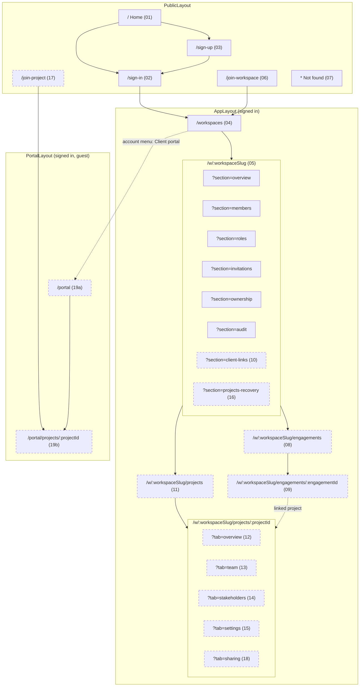
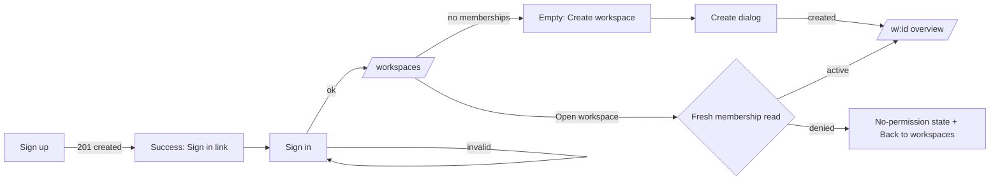
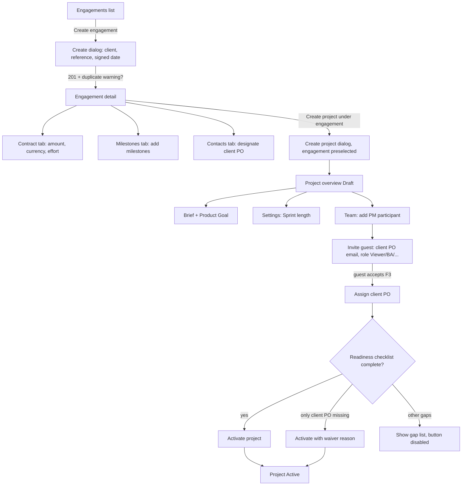
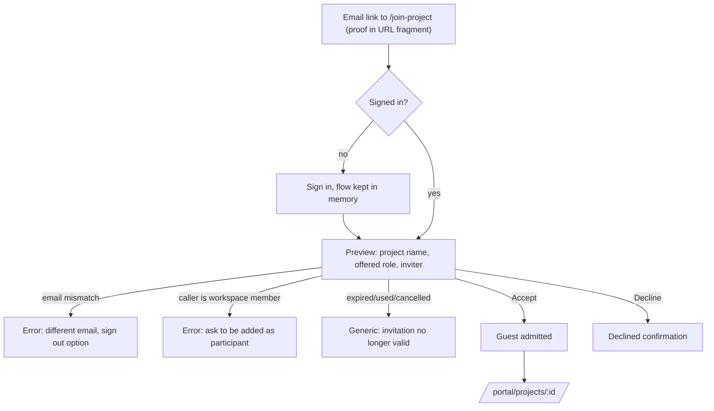
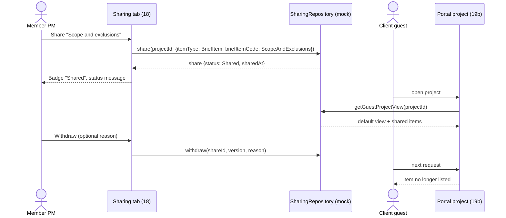
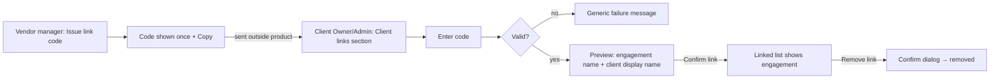
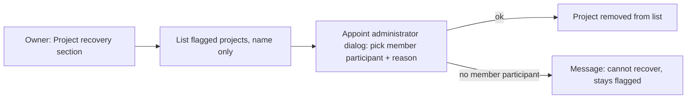

# 02 — Sitemap, routes and user flows

## 1. Sitemap

Solid boxes are approved routes in `src/lib/routes.ts`. Dashed boxes are routes approved on 11 Nov 2026 (T0-01) that are not yet in `routes.ts`; task T0-03 adds them.

## 2. Route table

| #         | Page                          | Route constant (proposed key)                     | Path                                               | Layout     | Status               |
| --------- | ----------------------------- | ------------------------------------------------- | -------------------------------------------------- | ---------- | -------------------- |
| 01        | Home                          | `home`                                            | `/`                                                | Public     | Approved             |
| 02        | Sign in                       | `signIn`                                          | `/sign-in`                                         | Public     | Approved             |
| 03        | Sign up                       | `signUp`                                          | `/sign-up`                                         | Public     | Approved             |
| 04        | Workspaces                    | `workspaces`                                      | `/workspaces`                                      | App        | Approved             |
| 05        | Workspace overview + sections | `workspaceOverview`                               | `/w/:workspaceSlug?section=`                       | App        | Approved             |
| 06        | Join workspace                | `joinWorkspace`                                   | `/join-workspace#…`                                | Public     | Approved             |
| 07        | Not found                     | `notFound`                                        | `*`                                                | Public     | Approved             |
| 08        | Engagements                   | `workspaceEngagements`                            | `/w/:workspaceSlug/engagements`                    | App        | Approved 11 Nov 2026 |
| 09        | Engagement detail             | `workspaceEngagement`                             | `/w/:workspaceSlug/engagements/:engagementId?tab=` | App        | Approved 11 Nov 2026 |
| 10        | Client links (client side)    | — (new `WORKSPACE_SECTIONS` value `client-links`) | `/w/:workspaceSlug?section=client-links`           | App        | Approved 11 Nov 2026 |
| 11        | Projects                      | `workspaceProjects`                               | `/w/:workspaceSlug/projects`                       | App        | Approved 11 Nov 2026 |
| 12–15, 18 | Project detail tabs           | `workspaceProject`                                | `/w/:workspaceSlug/projects/:projectId?tab=`       | App        | Approved 11 Nov 2026 |
| 16        | Project recovery              | — (section `projects-recovery`)                   | `/w/:workspaceSlug?section=projects-recovery`      | App        | Approved 11 Nov 2026 |
| 17        | Join project                  | `joinProject`                                     | `/join-project#…`                                  | Public     | Approved 11 Nov 2026 |
| 19a       | Client portal home            | `portal`                                          | `/portal`                                          | Portal [A] | Approved 11 Nov 2026 |
| 19b       | Portal project                | `portalProject`                                   | `/portal/projects/:projectId`                      | Portal [A] | Approved 11 Nov 2026 |

`:engagementId` and `:projectId` are UUIDs validated with the same regex as `isWorkspaceOverviewPath`; an invalid value renders page 07 without any request. [A] `PortalLayout` = `AppLayout` shell without workspace switcher and with a single nav item "My projects" (OQ-UI-02).

## 3. Navigation

**App sidebar (inside a workspace)** — groups from `SidebarNav.tsx`:

| Group     | Item                                          | Target              | Visible when                                                                    |
| --------- | --------------------------------------------- | ------------------- | ------------------------------------------------------------------------------- |
| Workspace | Overview                                      | `?section=overview` | always                                                                          |
| Delivery  | Projects                                      | page 11             | always (list may be empty)                                                      |
| Delivery  | Engagements                                   | page 08             | caller holds `engagements.create`, `read-all` or `manage`, or is a creator [A7] |
| Manage    | Members, Roles, Invitations, Ownership, Audit | existing sections   | unchanged rules                                                                 |
| Manage    | Client links                                  | page 10             | caller is Owner or Admin                                                        |
| Manage    | Project recovery                              | page 16             | caller is Owner                                                                 |

**Account menu** (`UserAccountMenu.tsx`): add "Client portal" → `/portal` (always shown; the portal shows an empty state when the user has no guest participation). No Backlog/Sprints/Requirements items (OQ-UI-11).

**Breadcrumbs** (`PageHeader`): `Workspaces › <Workspace name> › Projects › <Project name>`; `Workspaces › <Workspace name> › Engagements › <Client display name>`; portal: `Client portal › <Project name>`.

## 4. Key flows

### F1 — Account and workspace entry (existing)

### F2 — Engagement to active client project (VS-02 vendor side)

### F3 — Guest admission

### F4 — Share and withdraw (vendor) → read (guest)

### F5 — Client organization link (cross-workspace)

### F6 — Orphaned project recovery

