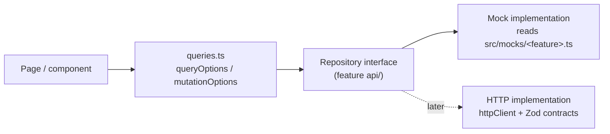

# Repository interfaces and mock strategy

Goal: pages and components never know whether data comes from fixtures or HTTP. Replacing the mock with a real implementation must change **one file per feature** (`<feature>Repository.ts` provider) and no UI.

Approved 11 Nov 2026 (T0-02): multi-file fixtures in `src/mocks/` and production mock repositories. Recorded in `AGENTS.md` and `docs/frontend/architecture.md`.

## 1. Layering



- `src/features/<feature>/api/<feature>Repository.ts` — interface + `get<Feature>Repository()` selector.
- `src/features/<feature>/api/mock<Feature>Repository.ts` — in-memory implementation; clones fixtures on first use, mutates its own copy, resets on reload.
- `src/features/<feature>/api/queries.ts` — query keys prefixed by account + workspace scope (existing `queryScope.ts` pattern), calling the repository only.
- `src/mocks/<feature>.ts` — fictional records (JSON in this folder is the source to copy from).
- Components import `queries.ts` only. No component imports a repository or fixture (UI-COD-06 preserved for components).

Selector (one place to swap):

```ts
// src/features/engagements/api/engagementRepository.ts
export function getEngagementRepository(): EngagementRepository {
  return mockEngagementRepository; // T-later: return httpEngagementRepository;
}
```

## 2. Mock behavior contract

| Behavior       | Rule                                                                                                                                                                                                                                                                                                                                                                                                                                                                                                                                           |
| -------------- | ---------------------------------------------------------------------------------------------------------------------------------------------------------------------------------------------------------------------------------------------------------------------------------------------------------------------------------------------------------------------------------------------------------------------------------------------------------------------------------------------------------------------------------------------- |
| Latency        | `await delay(400)` on every call [A6] so loading states are visible                                                                                                                                                                                                                                                                                                                                                                                                                                                                            |
| Identity       | Mocks act as a fixture **persona**, not the real signed-in user (real user IDs never appear in fixtures). Default persona `u-linh` (member PM, holds `projects.create`, `engagements.create`, `engagements.read-all`). Tests switch persona with the test-only `__setMockPersona(key)`. Real workspace admission still runs first; the mock then serves its fixtures for whichever admitted `workspaceId` is in the URL, rewriting fixture `organizationId` to that ID. The portal (no workspace) serves `portal.json` for persona `u-tomasz`. |
| Authorization  | Mock enforces the permission matrix in `01-requirements.md` §6 and throws `ApiError("forbidden")` / `ApiError("not-found")` exactly as the real API would, so UI denial paths are exercised                                                                                                                                                                                                                                                                                                                                                    |
| Validation     | Same limits as the FRs; throws field errors with the existing `useServerFieldErrors` shape                                                                                                                                                                                                                                                                                                                                                                                                                                                     |
| Versions       | Every write requires `expectedVersion`; mismatch throws `ApiError("conflict")`                                                                                                                                                                                                                                                                                                                                                                                                                                                                 |
| IDs / time     | `crypto.randomUUID()`; `new Date().toISOString()`                                                                                                                                                                                                                                                                                                                                                                                                                                                                                              |
| Failure switch | `__setMockFailure(operation, error)` exported **only** for tests (not reachable from URL or UI)                                                                                                                                                                                                                                                                                                                                                                                                                                                |
| Kind           | `kind: "mock"` → pages render `MockDataBanner`; success copy appends "(sample data — not saved to a server)"                                                                                                                                                                                                                                                                                                                                                                                                                                   |

## 3. Interfaces

```ts
export interface EngagementRepository {
  readonly kind: RepositoryKind;
  list(
    workspaceId: Uuid,
    params: {
      status?: EngagementStatus;
      limit?: number;
      cursor?: string | null;
    },
    signal?: AbortSignal,
  ): Promise<Page<EngagementDetail>>;
  get(
    workspaceId: Uuid,
    engagementId: Uuid,
    signal?: AbortSignal,
  ): Promise<EngagementDetail>;
  history(
    workspaceId: Uuid,
    engagementId: Uuid,
    params: { limit?: number; cursor?: string | null },
    signal?: AbortSignal,
  ): Promise<Page<EngagementHistoryEntry>>;
  create(
    workspaceId: Uuid,
    request: CreateEngagementRequest,
    idempotencyKey: string,
  ): Promise<CreateEngagementResult>;
  setContractValue(
    workspaceId: Uuid,
    engagementId: Uuid,
    request: SetContractValueRequest,
  ): Promise<EngagementDetail>;
  close(
    workspaceId: Uuid,
    engagementId: Uuid,
    request: CloseOrReopenEngagementRequest,
  ): Promise<EngagementDetail>;
  reopen(
    workspaceId: Uuid,
    engagementId: Uuid,
    request: CloseOrReopenEngagementRequest,
  ): Promise<EngagementDetail>;
  addMilestone(
    workspaceId: Uuid,
    engagementId: Uuid,
    request: AddMilestoneRequest,
  ): Promise<EngagementMilestone>;
  editMilestone(
    workspaceId: Uuid,
    engagementId: Uuid,
    milestoneId: Uuid,
    request: EditMilestoneRequest,
  ): Promise<EngagementMilestone>;
  changeMilestoneDate(
    workspaceId: Uuid,
    engagementId: Uuid,
    milestoneId: Uuid,
    request: ChangeMilestoneDateRequest,
  ): Promise<EngagementMilestone>;
  changeMilestoneStatus(
    workspaceId: Uuid,
    engagementId: Uuid,
    milestoneId: Uuid,
    request: ChangeMilestoneStatusRequest,
  ): Promise<EngagementMilestone>;
  // contract pending (G6)
  updateDetails(
    workspaceId: Uuid,
    engagementId: Uuid,
    request: UpdateEngagementDetailsRequest,
  ): Promise<EngagementDetail>;
  upsertContact(
    workspaceId: Uuid,
    engagementId: Uuid,
    contactId: Uuid | null,
    request: UpsertContactRequest,
  ): Promise<EngagementDetail>;
  removeContact(
    workspaceId: Uuid,
    engagementId: Uuid,
    contactId: Uuid,
    expectedVersion: Version,
  ): Promise<EngagementDetail>;
  issueLinkCode(
    workspaceId: Uuid,
    engagementId: Uuid,
    expectedVersion: Version,
  ): Promise<IssuedLinkCode>;
  removeClientLink(
    workspaceId: Uuid,
    engagementId: Uuid,
    expectedVersion: Version,
    reason: string | null,
  ): Promise<EngagementDetail>;
  linkedProjects(
    workspaceId: Uuid,
    engagementId: Uuid,
    signal?: AbortSignal,
  ): Promise<LinkedProjectSummary[]>;
}

/** Client-workspace side (page 10). */
export interface ClientLinkRepository {
  readonly kind: RepositoryKind;
  preview(clientWorkspaceId: Uuid, code: string): Promise<LinkPreview>;
  confirm(clientWorkspaceId: Uuid, code: string): Promise<LinkedEngagement>;
  listLinked(
    clientWorkspaceId: Uuid,
    signal?: AbortSignal,
  ): Promise<LinkedEngagement[]>;
  remove(
    clientWorkspaceId: Uuid,
    engagementId: Uuid,
    expectedVersion: Version,
  ): Promise<void>;
}

export interface ProjectRepository {
  readonly kind: RepositoryKind;
  listMine(workspaceId: Uuid, signal?: AbortSignal): Promise<ProjectListItem[]>;
  get(
    workspaceId: Uuid,
    projectId: Uuid,
    signal?: AbortSignal,
  ): Promise<ProjectDetail>;
  create(
    workspaceId: Uuid,
    request: CreateProjectRequest,
    idempotencyKey: string,
  ): Promise<ProjectDetail>;
  getBrief(
    workspaceId: Uuid,
    projectId: Uuid,
    signal?: AbortSignal,
  ): Promise<ProjectBrief>;
  updateBriefItem(
    workspaceId: Uuid,
    projectId: Uuid,
    request: UpdateBriefItemRequest,
  ): Promise<ProjectBrief>;
  setSprintLength(
    workspaceId: Uuid,
    projectId: Uuid,
    weeks: 1 | 2 | 3 | 4,
    expectedVersion: Version,
  ): Promise<ProjectDetail>;
  changeEngagement(
    workspaceId: Uuid,
    projectId: Uuid,
    request: {
      expectedVersion: Version;
      kind: ProjectKind;
      engagementId: Uuid | null;
      reason: string;
    },
  ): Promise<ProjectDetail>;
  activate(
    workspaceId: Uuid,
    projectId: Uuid,
    request: ActivateProjectRequest,
  ): Promise<ProjectDetail>;
  history(
    workspaceId: Uuid,
    projectId: Uuid,
    params: { cursor?: string | null },
    signal?: AbortSignal,
  ): Promise<Page<ProjectEvent>>;
  // team
  listParticipants(
    workspaceId: Uuid,
    projectId: Uuid,
    signal?: AbortSignal,
  ): Promise<Participant[]>;
  addParticipant(
    workspaceId: Uuid,
    projectId: Uuid,
    request: { userId: Uuid; roles: ProjectRoleCode[] },
  ): Promise<Participant>;
  changeRoles(
    workspaceId: Uuid,
    projectId: Uuid,
    participantId: Uuid,
    request: { roles: ProjectRoleCode[]; expectedVersion: Version },
  ): Promise<Participant>;
  endParticipation(
    workspaceId: Uuid,
    projectId: Uuid,
    participantId: Uuid,
    request: { expectedVersion: Version; reason: string | null },
  ): Promise<void>; // remove member / revoke guest
  leave(projectId: Uuid): Promise<void>; // guest
  assignClientPo(
    workspaceId: Uuid,
    projectId: Uuid,
    participantId: Uuid | null,
    expectedVersion: Version,
  ): Promise<ProjectDetail>;
  // guest invitations
  listInvitations(
    workspaceId: Uuid,
    projectId: Uuid,
    signal?: AbortSignal,
  ): Promise<GuestInvitation[]>;
  inviteGuest(
    workspaceId: Uuid,
    projectId: Uuid,
    request: {
      recipientEmail: string;
      offeredRoleCode: GuestInvitation["offeredRoleCode"];
    },
  ): Promise<GuestInvitation>;
  resendInvitation(
    workspaceId: Uuid,
    projectId: Uuid,
    invitationId: Uuid,
    expectedVersion: Version,
  ): Promise<GuestInvitation>;
  cancelInvitation(
    workspaceId: Uuid,
    projectId: Uuid,
    invitationId: Uuid,
    expectedVersion: Version,
  ): Promise<GuestInvitation>;
  // stakeholders
  listStakeholders(
    workspaceId: Uuid,
    projectId: Uuid,
    includeRetired: boolean,
    signal?: AbortSignal,
  ): Promise<Stakeholder[]>;
  saveStakeholder(
    workspaceId: Uuid,
    projectId: Uuid,
    stakeholderId: Uuid | null,
    request: Omit<Stakeholder, "id" | "retiredAt">,
  ): Promise<Stakeholder>;
  retireStakeholder(
    workspaceId: Uuid,
    projectId: Uuid,
    stakeholderId: Uuid,
    expectedVersion: Version,
  ): Promise<void>;
  // recovery (Owner)
  listOrphaned(
    workspaceId: Uuid,
    signal?: AbortSignal,
  ): Promise<OrphanedProject[]>;
  appointAdministrator(
    workspaceId: Uuid,
    projectId: Uuid,
    request: { participantId: Uuid; reason: string },
  ): Promise<void>;
}

/** Proof-bearing calls are imperative and never cached (same rule as workspace invitations). */
export interface ProjectInvitationResponseRepository {
  readonly kind: RepositoryKind;
  preview(invitationId: Uuid, proof: string): Promise<ProjectInvitationPreview>;
  accept(
    invitationId: Uuid,
    proof: string,
    expectedVersion: Version,
  ): Promise<{ projectId: Uuid }>;
  decline(
    invitationId: Uuid,
    proof: string,
    expectedVersion: Version,
  ): Promise<void>;
}

export interface SharingRepository {
  readonly kind: RepositoryKind;
  list(
    workspaceId: Uuid,
    projectId: Uuid,
    signal?: AbortSignal,
  ): Promise<GuestShare[]>;
  share(
    workspaceId: Uuid,
    projectId: Uuid,
    item: {
      itemType: ShareItemType;
      briefItemCode?: BriefItemCode;
      stakeholderId?: Uuid;
    },
  ): Promise<GuestShare>;
  withdraw(
    workspaceId: Uuid,
    projectId: Uuid,
    shareId: Uuid,
    request: { expectedVersion: Version; reason: string | null },
  ): Promise<GuestShare>;
  history(
    workspaceId: Uuid,
    projectId: Uuid,
    params: { cursor?: string | null },
    signal?: AbortSignal,
  ): Promise<Page<ShareEvent>>;
}

export interface PortalRepository {
  readonly kind: RepositoryKind;
  listMyGuestProjects(signal?: AbortSignal): Promise<GuestProjectListItem[]>;
  getProjectView(
    projectId: Uuid,
    signal?: AbortSignal,
  ): Promise<GuestProjectView>;
}
```

## 4. Query keys

```ts
["account", userId, "workspace", workspaceId, "engagements", { status }][
  ("account", userId, "workspace", workspaceId, "engagement", engagementId)
][
  ("account",
  userId,
  "workspace",
  workspaceId,
  "engagement",
  engagementId,
  "history")
][("account", userId, "workspace", workspaceId, "projects", "mine")][
  ("account",
  userId,
  "workspace",
  workspaceId,
  "project",
  projectId,
  "detail" |
    "brief" |
    "participants" |
    "invitations" |
    "stakeholders" |
    "shares" |
    "history")
][("account", userId, "portal", "projects")][
  ("account", userId, "portal", "project", projectId)
];
```

Mutations invalidate the narrowest keys: e.g. `share` → `["…","project",projectId,"shares"]` and `["account",userId,"portal"]`.

## 5. Swap checklist (when an endpoint lands)

1. Verify DTO against source; update `types.md` and Zod contract; mark `[DTO]`.
2. Implement `http<Feature>Repository` with the shared `httpClient`, `unwrapApiResponse`, Zod parse.
3. Switch the selector; remove `MockDataBanner` for that page (it follows `kind`).
4. Delete fixture usage from production code; keep fixtures for tests under `src/test/fixtures`.
5. Run typecheck, lint, format:check, test:run, build.
